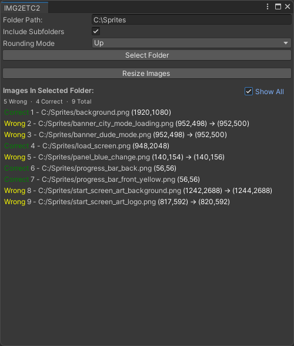

#  IMG2ETC2

Resize source textures to dimensions divisible by 4 for ETC2/Crunch workflows in Unity.

**Technical details**: ETC2 is a block-based compression format that processes images in 4x4 pixel blocks. Learn more in Unity's [documentation](https://docs.unity3d.com/2023.2/Documentation/Manual/class-TextureImporterOverride.html) or this [technical post](https://unity.com/ru/blog/engine-platform/crunch-compression-of-etc-textures).

## Before resizing

Use a copy of your textures or create a restore point that includes the source images and their Unity `.meta` files. Check the selected folder and **Include subfolders** before running the batch.

- The current resize operation resamples the entire image. This can change pixel art and sprite sheet alignment.
- Resizing a JPG or JPEG writes a PNG and deletes the source file. This can overwrite an existing PNG with the same name and break Unity references to the original asset.
- The Inspector may show the previous resolution until Unity reimports the file. Check your platform import settings to confirm the actual compression format.

## Quick Start

1. Install via Package Manager: `https://github.com/llarean/img2etc2.git`
2. Open `Tools > IMG2ETC2`
3. Select your textures folder
4. Choose rounding mode (Up or Down)
5. Click "Resize images"

## INSTALLATION

There are 4 ways to install this utility:

- import [UnityIMG2ETC2.unitypackage](https://github.com/llarean/img2etc2/releases) via *Assets-Import Package*
- clone/[download](https://github.com/llarean/img2etc2/archive/main.zip) this repository and move files to your Unity project's *Assets* folder
- import it from [Asset Store](https://assetstore.unity.com/preview/315139/1042556) *(may lag behind)*
- *(via Package Manager)* Select Add package from git URL from the add menu. A text box and an Add button appear. Enter a valid Git URL in the text box:
  - `https://github.com/llarean/img2etc2.git`
- *(via Package Manager)* add the following line to *Packages/manifest.json*:
  - `"com.llarean.img2etc2": "https://github.com/llarean/img2etc2.git"`

## HOW TO

1. Open `Tools > IMG2ETC2`.
2. Select a folder (2 ways):
   - Click on the "Select folder" button; or
   - Specify "Folder path:" in the input field
3. Toggle "Include subfolders" if needed
4. Choose **Rounding Mode**: `Up` rounds dimensions up to the next multiple of 4, `Down` rounds down
5. Review the image list — by default only **Wrong** (incompatible) images are shown; enable "Show All" to see all textures
6. Check resolution preview: each entry shows current and target resolution (`1920×1081 → 1920×1084`)
7. Click "Resize images"

## Project Status

The project is in maintenance mode. See [Before resizing](#before-resizing) for known limitations.

**Current maintenance approach:**

- **Bug fixes**: Addressed as reported
- **Minor improvements**: Implemented based on community feedback  
- **New features**: Considered only if there's significant demand

**Need a feature?** Feel free to open an issue with your use case!

## Planned improvements

- Make batch conversion safer by detecting output conflicts before writing and preserving Unity asset references when converting JPEGs.
- Add transparent padding without resampling and cover padding, file conflicts, and asset references with Unity EditMode tests.
- Build and validate the `.unitypackage` on pull requests, then verify that it imports into a clean Unity project before release.

[Detailed implementation plan](Documentation~/FIX_PLAN.md)

## Contributing

While this project is feature-complete, contributions are welcome:

- **Bug reports**: [Open an issue](https://github.com/llarean/img2etc2/issues)
- **Feature requests**: Describe your use case in an issue
- **Pull requests**: For bug fixes or minor improvements

## Special thanks

[Nintoryan](https://github.com/Nintoryan) (For your inspiration and main idea)

---

If this project helped you, please consider giving it a star.
